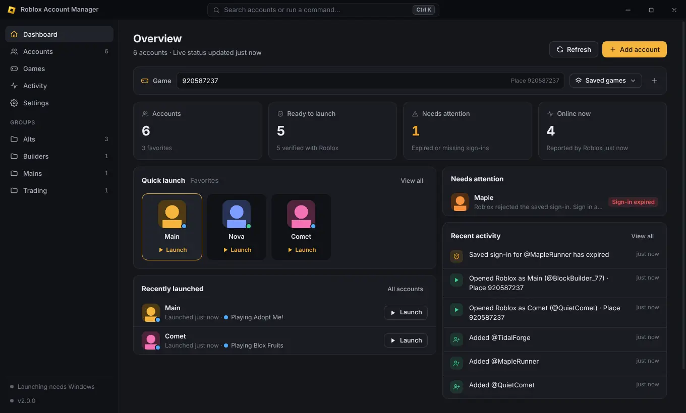

# Roblox Account Manager

A free, open-source Windows app that keeps all your Roblox accounts organized and opens any of
them — or several at once — already signed in. Sign-ins are encrypted on your own PC and never
leave it except to talk to Roblox itself.



**Free, with no catch:** no paid version, no subscription, no ads, no accounts, no tracking.
MIT licensed. Project website: `https://sacttt.github.io/roblox-account-manager/` (once GitHub
Pages is enabled, see [website/README.md](website/README.md)).

## Features

- **As many accounts as you like**, as cards or a compact table. Nicknames, groups, tags,
  private notes, favorites and pins. Search, filter (favorites, online, ready to launch,
  needs attention, group, tag) and sort.
- **One-click launch** into any game, private server or specific server, signed in as the
  right account. Paste a Place ID or almost any Roblox game link.
- **Launch Together:** select several accounts and open them one after another, each in its
  own Roblox window, with progress and a Cancel button.
- **Multi Roblox** (several Roblox windows at once) and a fix for error 773.
- **Works with the official launcher, Bloxstrap and Fishstrap** (detected automatically).
- **Honest live status:** online / in game / in Studio from Roblox, always labelled with how
  fresh it is. Unknown is shown as unknown, never guessed.
- **Sign-in health:** see which accounts are verified, expired or missing a sign-in, and fix
  them in a click.
- **Saved games & servers**, recent games, and a quick-launch menu in the system tray.
- **Command palette** (Ctrl K) and keyboard shortcuts for everything.
- **Backups** of your organization (never your sign-ins), restore, activity history,
  diagnostics with a copyable (secret-free) report.
- **8 themes** including a light one, custom accent color, compact density, reduced motion.
- **Updates** from GitHub Releases, verified before installing, only when you say so.

## Install

1. Go to the [latest release](https://github.com/Sacttt/roblox-account-manager/releases/latest).
2. Download **`RobloxAccountManager-Setup-<version>.exe`** and run it. It installs for your
   Windows user only — no administrator rights needed — and adds Start menu and desktop
   shortcuts. You can uninstall it from *Settings → Apps* like any other app (your accounts are
   kept unless you delete the data folder).
   - Prefer no installation? Download **`RobloxAccountManager-Portable-<version>.exe`** and run it
     from anywhere. The portable copy doesn't update itself; download the new one when a release
     comes out. It uses the same data folder as the installed app.
3. Windows SmartScreen may say *"Windows protected your PC"* because the app isn't code-signed.
   Click **More info → Run anyway**.

Requires Windows 10 or 11 (64-bit) and Roblox installed.

## Getting started

1. **Add an account** (Ctrl N): either **Sign in with Roblox** — Roblox's own login page opens in
   a private window and the app keeps only the resulting sign-in — or paste a `.ROBLOSECURITY`
   cookie. Either way the account is checked with Roblox and shown to you before it's saved.
   Adding an account that's already in your list offers to update its sign-in instead.
2. **Launch:** press **Launch** on an account card. Choose the game in the launch bar at the top
   (Place ID, a game link, a private server link or a saved game — Alt G opens the saved list).
3. **Launch several:** select accounts (click their checkboxes, or Ctrl A), then press
   **Launch Together** (or Ctrl Enter). Keep **Settings → Launching → Multi Roblox** on and
   close Roblox before the first launch.

### Keyboard shortcuts

| Keys | Action |
| --- | --- |
| Ctrl K | Command palette: search accounts and run commands |
| Ctrl N | Add an account |
| Ctrl F | Search accounts |
| Ctrl R | Refresh status, names and avatars |
| Ctrl 1 … 5 | Dashboard, Accounts, Games, Activity, Settings |
| Ctrl A | Select every visible account |
| Ctrl Enter | Launch the selected accounts |
| Delete | Remove the selected accounts (asks first) |
| Alt G | Pick a saved game |
| Esc | Close menus, dialogs and panels; clear the selection |
| Shift ? | Show all shortcuts |

An optional global shortcut to show/hide the app from anywhere can be set in
*Settings → General*.

## Your sign-ins and privacy

- A sign-in (the `.ROBLOSECURITY` cookie) gives full access to a Roblox account. The app stores
  them **encrypted with Windows DPAPI** (Electron `safeStorage`), tied to your Windows user, in a
  separate `secrets.json`. If encryption isn't available, sign-ins are kept in memory only for
  that session and never written to disk in plain text.
- Sign-ins **never reach the app's window/UI code**, and are kept out of logs, the activity
  history, diagnostics reports and backups.
- The app only talks to **Roblox's own servers** (and to GitHub to check for updates). Nothing is
  sent anywhere else. There is no analytics or telemetry.
- To launch an account the app asks Roblox for a one-time ticket — the same thing the Play button
  on roblox.com does — and hands it to the Roblox app.
- **Never share a cookie** or a `roblox-player:` link with anyone. Anyone asking for one is trying
  to steal your account.

## Where your data lives

`%APPDATA%\roblox-account-manager\` (open it from *Settings → Data & backup → Open folder*):

| File | Contents |
| --- | --- |
| `accounts.json` | Your list: names, nicknames, groups, tags, notes, last status (no sign-ins) |
| `secrets.json` | Encrypted sign-ins |
| `settings.json`, `presets.json` | Preferences and saved games |
| `activity.json` | Activity history (no secrets) |
| `avatar-cache\`, `custom-icons\` | Avatar pictures |
| `logs\main.log` | Log file (secrets removed) |

Files are written atomically with a `.bak` copy, so a crash or power cut can't leave them
half-written; a damaged file is set aside and the backup is used.

### Upgrading from 1.x

Just install 2.0 over it (or run it next to the old copy). On first start, your existing
accounts, sign-ins, nicknames, notes, groups, favorites, custom icons, saved games and settings
are carried over automatically. Before converting, the app saves `accounts.pre-v2-backup.json`
(without sign-ins) and `settings.pre-v2-backup.json` in the data folder. Accounts whose saved
sign-in was already expired are marked so you can sign in again.

## Troubleshooting

- **Only one Roblox window opens:** turn on Multi Roblox, close every Roblox window
  (*Settings → Launching → Close Roblox*), then launch again.
- **"Sign-in expired":** Roblox signed that account out (password change, "log out of all
  sessions", or age). Open the account and choose **Sign in again**.
- **Error 773 or accounts swapping:** close all Roblox windows and launch with Multi Roblox on.
- **"Roblox isn't installed":** install Roblox from roblox.com (or Bloxstrap/Fishstrap), then
  try again. You can pick the launcher in *Settings → Launching*.
- **Share links (`roblox.com/share?...`)** can't be used directly; open the link in a browser
  and copy the game or private server link it leads to.
- **Status shows "unknown":** live status hasn't been fetched yet or Roblox can't be reached.
  Press Ctrl R, or use *Settings → Diagnostics → Run checks*.
- **Something else:** *Settings → Diagnostics → Copy report* copies a report without any
  secrets that you can attach to an
  [issue](https://github.com/Sacttt/roblox-account-manager/issues).

**Heads up:** Roblox's anti-cheat vendor has said running multiple clients may be treated as
suspicious, and farming/trading abuse with alts is against Roblox's Terms of Use. Use at your
own risk. This project isn't affiliated with Roblox Corporation.

## Building from source

Requires [Node.js](https://nodejs.org) 22 or newer.

- **Windows, one click:** double-click **`build.bat`**. It installs dependencies, runs the checks
  and builds the installer and portable app into `dist\`.
- **Command line:**

  ```
  npm ci
  npm start              # run the app from source
  npm test               # lint + unit tests + end-to-end tests
  npm run build          # installer + portable exe in dist/ (Windows, or Linux with Wine)
  ```

The end-to-end tests drive the real app against a local fake Roblox server
(`test/support/mock-roblox.js`), so they never touch real accounts. On Linux without a display
they run under `xvfb-run` automatically.

Every push is checked by GitHub Actions (lint, unit and end-to-end tests, and a Windows build
whose installer can be downloaded from the run's *Artifacts*). Publishing a release is described
in [RELEASING.md](RELEASING.md).

### Project structure

```
src/main/            Electron main process
  index.js           App start-up, window, tray, global shortcut, timers
  ipc.js             Every action the UI can ask for (validated)
  protocol.js        Serves the UI and avatars over app://ram
  accounts.js        Accounts: add, verify, refresh, remove, migrate from 1.x
  vault.js           Encrypted sign-in storage (safeStorage / DPAPI)
  launcher.js        Launch and Launch Together
  multiroblox.js     Multi Roblox helper (singleton mutex + error 773 fix)
  web-login.js       "Sign in with Roblox" window
  roblox/            Roblox API client (timeouts, retries, rate limits), launch links, launcher detection
  json-store.js      Crash-safe JSON files with backups
  settings.js, presets.js, backup.js, activity.js, avatars.js, diagnostics.js, updater.js, logger.js, redact.js
src/preload/         The small, allow-listed bridge between UI and main process
src/renderer/        The UI (plain JavaScript modules, no framework)
  js/views/          Dashboard, Accounts, Games, Activity, Settings
  js/components/     Account cards, details panel, add-account dialog, launch bar
assets/              App icon
test/                Unit tests, end-to-end tests and the fake Roblox server
scripts/             Icon generator and the screenshot tool used for the website
website/             The project website (GitHub Pages)
```

## License

[MIT](LICENSE) © Sacttt
